<!--
  Profile README for github.com/apollo0515.
  Graphics in assets/ are generated by `npm run build` (edit the data at the top of scripts/build.mjs).
  stats.svg and snake-*.svg are drawn daily by .github/workflows/profile.yml into the `output` branch.
-->


<picture>
  <source media="(prefers-color-scheme: dark)" srcset="assets/intro-dark.svg"/>
  
</picture>

 

I'm a freelance full-stack developer who turns ambitious briefs into polished, production-ready products: real-time 3D and WebGL, booking engines and marketplaces, and headless WordPress for brands that care how things look and feel. I sweat the details clients notice (motion, typography, speed) and the ones they don't, like the tests that keep it all working.

 

<picture>
  <source media="(prefers-color-scheme: dark)" srcset="assets/section-work-dark.svg"/>
  
</picture>

  <a href="https://github.com/apollo0515/orbis"></a>
  <a href="https://github.com/apollo0515/vitalia-health"></a>
  <a href="https://github.com/apollo0515/atrium"></a>
  <a href="https://github.com/apollo0515/aurelia"></a>
  <a href="https://github.com/apollo0515/aeralis-air"></a>
  <a href="https://github.com/apollo0515/strikezone"></a>

  Also built: <b>Roam &amp; Relish</b>, a travel journal with a tours marketplace · <b>Lumina</b>, a modern WordPress starter · <b>Wardro</b>, a premium one-product site · custom <b>Shopify</b> storefronts

 

<picture>
  <source media="(prefers-color-scheme: dark)" srcset="assets/section-toolkit-dark.svg"/>
  
</picture>

  

  

 

<picture>
  <source media="(prefers-color-scheme: dark)" srcset="assets/section-activity-dark.svg"/>
  
</picture>

  

  <picture>
    <source media="(prefers-color-scheme: dark)" srcset="https://raw.githubusercontent.com/apollo0515/apollo0515/output/snake-dark.svg"/>
    
  </picture>

 

<picture>
  <source media="(prefers-color-scheme: dark)" srcset="assets/section-contact-dark.svg"/>
  
</picture>

  Have a product that needs to look and feel exceptional? I'm taking on new freelance and contract work.

  <!-- Add your links here, e.g.
  
  
  
  -->
  

<picture>
  <source media="(prefers-color-scheme: dark)" srcset="assets/footer-dark.svg"/>
  
</picture>
